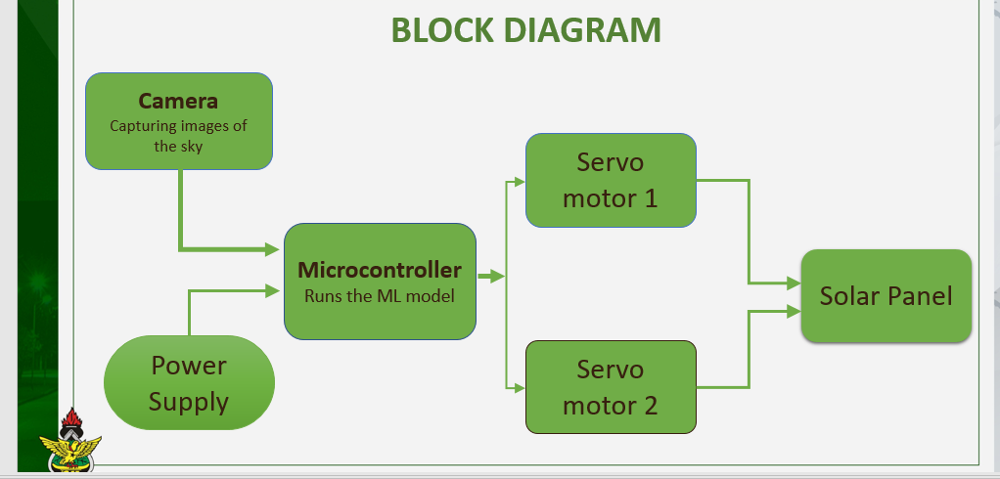
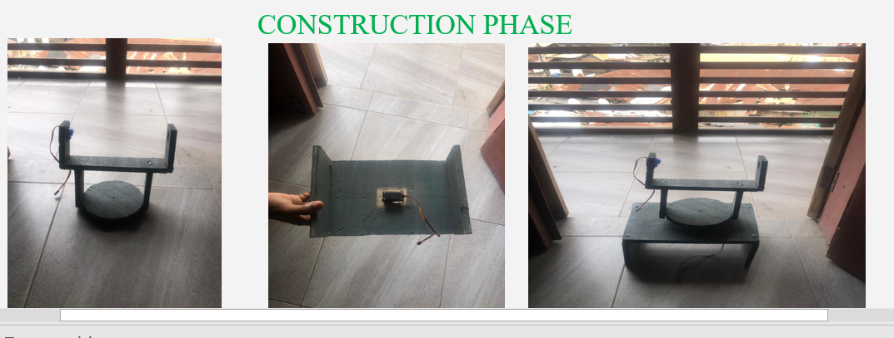
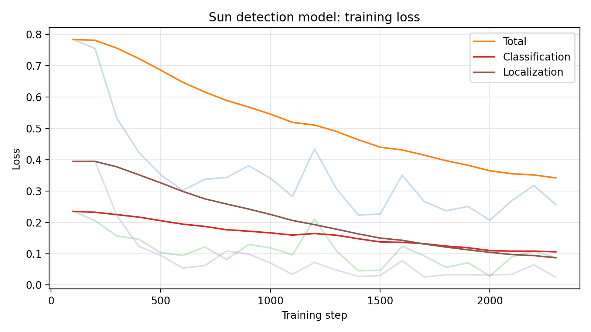
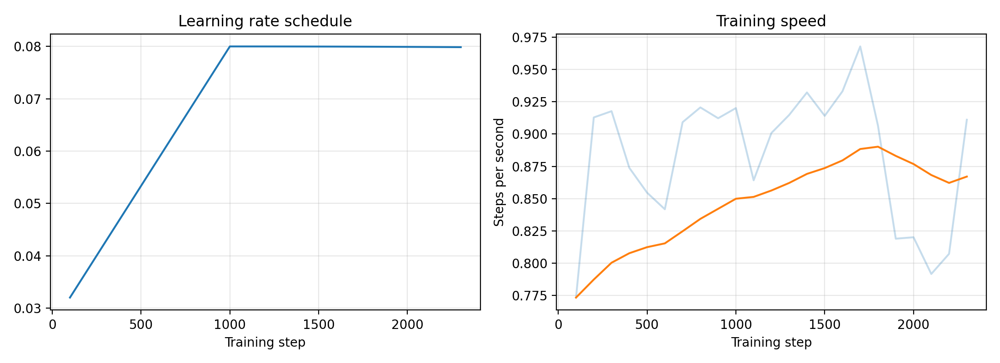
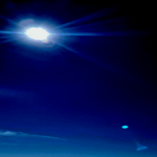
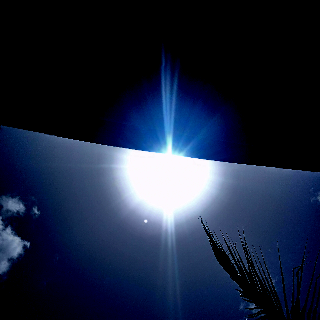
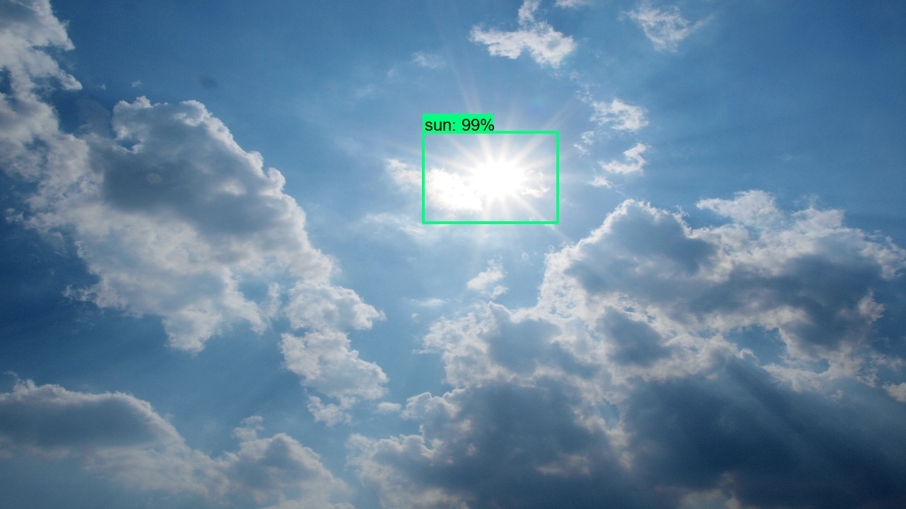
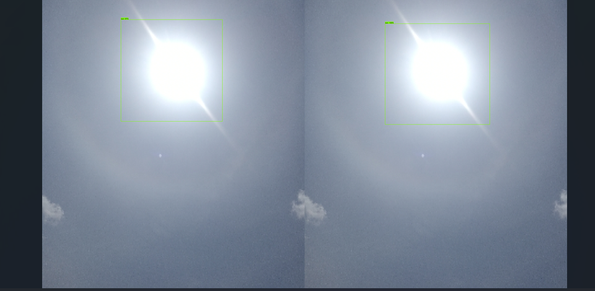
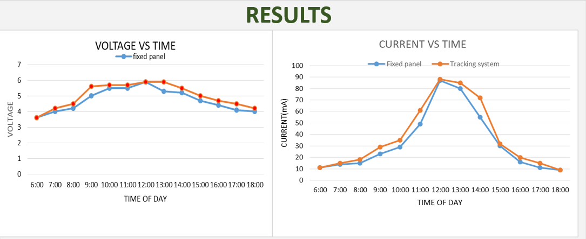

# Adaptive solar tracker using machine learning

A camera and a small neural network find the sun, and two servo motors point a solar panel at it. In our field test, the tracking panel produced 18.6% more power than a fixed panel.

<p align="center">
  
</p>

This is the final-year project of three Electrical and Electronics Engineering students at Kwame Nkrumah University of Science and Technology (KNUST), supervised by Mr. Peter Asigri. We trained the sun detector by following Nicholas Renotte's video [Real Time Sign Language Detection with Tensorflow Object Detection and Python](https://www.youtube.com/watch?v=pDXdlXlaCco) and his [RealTimeObjectDetection](https://github.com/nicknochnack/RealTimeObjectDetection) repository, and applied the same workflow to photos of the sky instead of hand signs.

| | |
|---|---|
| Detector | SSD MobileNet V2 FPNLite (320 x 320), one class: sun |
| Software | TensorFlow 2.10, TensorFlow Object Detection API, TensorFlow Lite |
| Hardware | Raspberry Pi, Raspberry Pi Camera Module V2, two servo motors, monocrystalline solar panel |
| Field test | 18.6% more power than a fixed panel (hourly multimeter readings over one day) |
| Detector test | mAP@0.5 = 1.000 and mAP@0.5:0.95 = 0.622 on 4 test images (a small test set, see [Limitations](#limitations)) |

## Background

A solar panel produces the most power when it faces the sun. A fixed panel points one way all day, while a tracker follows the sun across the sky. Conventional trackers work from a fixed rule or from simple light sensors, and they do not learn from the conditions they operate in. Earlier work on AI-driven trackers includes a neural-network controlled robotic-arm tracker that produced 20% more power than a fixed cell (Ilo, Onoh and Eke, 2014), and a camera-based approach that combines computer vision and deep learning to find the sun in images (Carballo et al., 2019). Full references are at the end.

We took the camera route. A camera sees the whole sky, which gives the model more information than a single light-dependent resistor, and the same video feed could later be used to watch for clouds.

## How it works

<p align="center">
  
</p>

The camera is mounted on the panel frame and photographs the sky. A Raspberry Pi runs the sun detector on those frames and uses the result to drive two servo motors: one rotates the platform and the other tilts the panel. Each frame is resized to 320 x 320 pixels before it goes to the model, which returns a bounding box and a confidence score for the sun.

We compared candidate parts before building. These are the choices and the main reason for each:

| Part | Choice | Reason |
|---|---|---|
| Solar panel | Monocrystalline | Highest efficiency of the three types we compared (17% to 22%) and good low-light performance |
| Controller | Raspberry Pi | Its 1.5 GHz CPU can run a TensorFlow Lite model, which a 16 MHz Arduino cannot. It draws more power (about 1.2 W, against 0.18 W for the Arduino) |
| Actuators | Servo motors | High accuracy and torque compared with stepper and DC motors |
| Camera | Raspberry Pi Camera Module V2 | 8 MP, up to 30 fps, 62.2 degree horizontal field of view |
| Model | Neural network | Can learn the appearance of the sun from images. We compared it with linear regression, decision trees and reinforcement learning |

## Build

<p align="center">
  
</p>

The base is a 25 x 22.8 cm wooden board with a 2 x 4 cm opening at the center for the rotation servo. A stem with two uprights stands on the platform and holds the panel frame. One upright houses the tilt servo and the other is the pivot. The camera is fixed to the panel frame, and all connections run to the Raspberry Pi.

## Dataset

We photographed and collected images of the sky with the sun at different positions and labelled each one with [labelImg](https://github.com/HumanSignal/labelImg), using a single class called `sun`. Labels are Pascal VOC XML files stored next to each image.

| Split | Labelled images | Folder |
|---|---|---|
| Train | 36 | `data/train` |
| Test | 4 | `data/test` |

The `IMG_...` files are phone photos taken by the team. The other images were collected from the web and belong to their original owners, so they are not covered by this repository's license. Forty images is enough for a working prototype, but it is far too few for a general sun detector.

## Model and training

We fine-tuned `ssd_mobilenet_v2_fpnlite_320x320_coco17_tpu-8` from the [TensorFlow 2 Detection Model Zoo](https://github.com/tensorflow/models/blob/master/research/object_detection/g3doc/tf2_detection_zoo.md) using transfer learning. The settings are in [`config/pipeline.config`](config/pipeline.config): one class, batch size 4, the model's default augmentation (random horizontal flip and random crop) and its default cosine learning-rate schedule. The whole workflow is in [`notebooks/training_script.ipynb`](notebooks/training_script.ipynb).

<p align="center">
  
</p>

The faint lines are the raw logged values and the solid lines are smoothed.

<p align="center">
  
</p>

The schedule in the config is written for 50,000 steps. We stopped training far earlier, so the learning rate stayed close to its peak of 0.08. Training speed was roughly one step per second on a laptop.

Two training inputs, as the model sees them (320 x 320, no boxes drawn):

<p align="center">
  
  
</p>

## Evaluation

We evaluated the checkpoint at step 2000 on the 4 images in `data/test` with the COCO metrics from the TensorFlow Object Detection API. The full output is in [`results/eval_test4.txt`](results/eval_test4.txt).

| Metric | Value |
|---|---|
| mAP@0.5:0.95 | 0.622 |
| mAP@0.5 | 1.000 |
| mAP@0.75 | 0.752 |
| Average recall (AR@100) | 0.675 |

The model found the sun in all four test images at an overlap (IoU) of 0.5. The scores fall at stricter overlap thresholds, which means the box is usually in the right place but is not always drawn tightly around the sun. Small and medium object scores are reported as -1 by the evaluator because every sun in the test images counts as a large object.

<p align="center">
  
  
</p>

The percentage on each box is the model's confidence score for that detection. It is not a measure of overall accuracy.

The image below is the TensorBoard evaluation view, which shows the model's detection and the hand-drawn label for the same image side by side.

<p align="center">
  
</p>

## Field test

We placed the tracker next to a fixed panel (visible in the photo at the top) and read voltage and current from a multimeter every hour. Power is voltage times current.

<p align="center">
  
</p>

<p align="center">
  
</p>

Over the test day the tracking system produced 18.6% more power than the fixed panel. The graph shows where the gain comes from. The two panels are almost level around noon, when both peak at roughly 520 mW, and again after about 16:00. The tracker is ahead by the largest margin on either side of midday, from about 11:00 to 14:00.

## Limitations

- The field test is one day of hourly readings against one fixed panel. A single day cannot show how the gain changes with season or weather.
- The 18.6% figure is gross panel output. The power drawn by the Raspberry Pi and the servos is not subtracted. The Pi alone draws about 1.2 W in our component comparison, which is more than this small panel's peak output of about 0.5 W. The prototype shows that the method works, and a net gain would need a larger panel.
- The dataset is small and mostly web photos, while the deployed camera is the Pi camera. Images from the Pi camera across several days would test the model on what it actually sees.
- Three of the four test photos were taken within seconds of training photos from the same session, so the test scores probably overstate performance on new scenes. A test set of four images also moves a lot when a single detection changes.
- The evaluated checkpoint is step 2000. Detection quality was measured offline on stored images, and live accuracy on the Pi was not measured.
- The tracker was compared with a fixed panel only, not with a conventional sensor-based or astronomical tracker.

Possible next steps are collecting more varied images from the Pi camera, setting the learning-rate schedule to match the real number of training steps, comparing against a conventional tracker, and using the camera feed to detect clouds for predictive tracking.

## Reproduce the work

The setup follows the [TensorFlow 2 Object Detection API tutorial](https://tensorflow-object-detection-api-tutorial.readthedocs.io/en/latest/install.html) and the video linked at the top. The tested versions are pinned in [`requirements.txt`](requirements.txt), and the project used Python 3.8.

1. Install the TensorFlow Object Detection API by following the tutorial, then run `pip install -r requirements.txt`.
2. Use the tutorial's `Tensorflow/workspace` layout. Put `data/train` and `data/test` in `Tensorflow/workspace/images`, and `config/label_map.pbtxt` in `Tensorflow/workspace/annotations`. The paths in `config/pipeline.config` assume this layout.
3. Create the TFRecord files:

   ```
   python Tensorflow/scripts/generate_tfrecord.py -x Tensorflow/workspace/images/train -l Tensorflow/workspace/annotations/label_map.pbtxt -o Tensorflow/workspace/annotations/train.record
   python Tensorflow/scripts/generate_tfrecord.py -x Tensorflow/workspace/images/test -l Tensorflow/workspace/annotations/label_map.pbtxt -o Tensorflow/workspace/annotations/test.record
   ```

4. Train:

   ```
   python Tensorflow/models/research/object_detection/model_main_tf2.py --model_dir=Tensorflow/workspace/models/my_ssd_mobnet --pipeline_config_path=Tensorflow/workspace/models/my_ssd_mobnet/pipeline.config --num_train_steps=5000
   ```

5. Evaluate. The script keeps waiting for new checkpoints after it prints the metrics, so press Ctrl+C once they appear:

   ```
   python Tensorflow/models/research/object_detection/model_main_tf2.py --model_dir=Tensorflow/workspace/models/my_ssd_mobnet --pipeline_config_path=Tensorflow/workspace/models/my_ssd_mobnet/pipeline.config --checkpoint_dir=Tensorflow/workspace/models/my_ssd_mobnet
   ```

6. View the curves with `tensorboard --logdir Tensorflow/workspace/models/my_ssd_mobnet`, or draw the figures in this README with `python scripts/plot_training_curve.py`.
7. Export the model and convert it to TensorFlow Lite. The export steps (`export_tflite_graph_tf2.py` followed by `tflite_convert`) are in the last cells of the notebook.

### Running the detector on the Raspberry Pi

Copy the contents of `pi/` to the Raspberry Pi, install TensorFlow, OpenCV and NumPy, and run:

```
python detect.py
```

The script reads the camera, runs `detect.tflite` on each frame, and draws a box around any sun detected with a confidence of 0.8 or higher. Press `q` to quit. It handles detection and display only. The code that turns the detection into servo movement is not included in this repository.

## Repository layout

```
.
├── README.md
├── requirements.txt
├── config/        pipeline.config and label_map.pbtxt
├── data/
│   ├── train/     labelled images (Pascal VOC XML)
│   └── test/
├── docs/          figures used in this README
├── hardware/      block diagram, build photos and field-test graphs
├── notebooks/     training_script.ipynb
├── pi/            detect.py, detect.tflite, labels.txt
├── results/       eval_test4.txt
└── scripts/       generate_tfrecord.py, plot_training_curve.py
```

## Credits

Project team: Adda Jabal Namansam, Alfred Battorow and Anokye Yeboah Nana. Supervisor: Dr. Peter Asigri.

- Nicholas Renotte's [video](https://www.youtube.com/watch?v=pDXdlXlaCco) and [repository](https://github.com/nicknochnack/RealTimeObjectDetection) for the training workflow.
- The [TensorFlow 2 Object Detection API tutorial](https://tensorflow-object-detection-api-tutorial.readthedocs.io/en/latest/install.html) for the installation steps and `generate_tfrecord.py`.
- The [TensorFlow Lite Raspberry Pi object detection example](https://github.com/tensorflow/examples/blob/master/lite/examples/object_detection/raspberry_pi/README.md), which `pi/detect.py` is based on.
- The pre-trained SSD MobileNet V2 FPNLite model from the TensorFlow 2 Detection Model Zoo.

## References

- F. U. Ilo, G. N. Onoh and J. Eke, "An Artificial Intelligent Based Solar Tracking System for Improving the Power Output of a Solar Cell", International Journal of Engineering Research & Technology, 2014. [doi:10.17577/IJERTV3IS110356](https://doi.org/10.17577/IJERTV3IS110356)
- J. A. Carballo, J. Bonilla, M. Berenguel, J. Fernandez-Reche and G. Garcia, "New approach for solar tracking systems based on computer vision, low cost hardware and deep learning", Renewable Energy, vol. 133, pp. 1158-1166, 2019. [Preprint on arXiv](https://arxiv.org/pdf/1809.07048)

## License

Released under the MIT License (see `LICENSE`). Images collected from the web remain the property of their owners.
